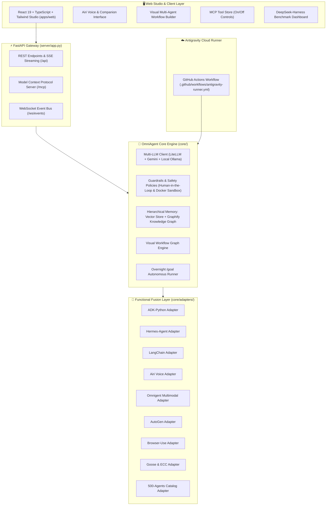

# AI Agents Ecosystem & OmniAgent OS Platform

A production-grade, unified AI Agent Operating System integrating 16 state-of-the-art open source repositories into a modular architecture with an interactive Web Studio, multi-provider LLM routing, and autonomous cloud execution.

## 📂 Included Repositories (16 Sources)

- **[microsoft/autogen](sources/autogen)** — Multi-agent conversational frameworks
- **[langchain-ai/langchain](sources/langchain)** — Agentic chains and tool integrations
- **[browser-use/browser-use](sources/browser-use)** — Headless and interactive browser automation
- **[aaif-goose/goose](sources/goose)** — Autonomous software engineering shell agent
- **[affaan-m/ECC](sources/ECC)** — Everything Computer Control (OS-level automation)
- **[google/adk-python](sources/adk-python)** — Google Agent Development Kit for structured tools
- **[NousResearch/hermes-agent](sources/hermes-agent)** — Advanced tool-calling & Hermes reasoning
- **[moeru-ai/airi](sources/airi)** — Real-time conversational companion & speech loop
- **[omnigent-ai/omnigent](sources/omnigent)** — Multimodal reasoning and event broker
- **[deepseek-ai/deepseek-harness](sources/deepseek-harness)** — Model and agent benchmarking suite
- **[Graphify-Labs/graphify](sources/graphify)** — Knowledge graph semantic memory
- **[google-gemini/gemini-cli](sources/gemini-cli)** — Terminal assistant and Gemini scripting
- **[ashishpatel26/500-AI-Agents-Projects](sources/500-AI-Agents-Projects)** — 500+ curated agent use cases
- **[NirDiamant/GenAI_Agents](sources/GenAI_Agents)** — Tutorials and architectural patterns
- **[microsoft/ai-agents-for-beginners](sources/ai-agents-for-beginners)** — Agent curricula and foundational patterns
- **[microsoft/agent-framework](sources/agent-framework)** — Enterprise multi-agent ecosystem

---

## 🏗️ Architecture Overview



---

## 🚀 Quickstart

### 1. Application Bureau Windows Native (`OmniAgentOS.exe`)

Double-cliquez directement sur **`OmniAgentOS.exe`** :
- Démarre automatiquement le serveur FastAPI en arrière-plan (sans fenêtre CMD intempestive).
- Ouvre directement le Studio Web React 19 dans votre navigateur par défaut (`http://localhost:8000`).
- Se loge dans la zone de notification (System Tray) avec menu contextuel (Ouvrir Studio, Documentation Swagger, Serveur MCP, Redémarrer, Quitter).
- Coupe proprement les processus enfants à la fermeture pour libérer les ports.

### 2. Démarrage Console en 1-Clic (`start.bat`)

Double-cliquez sur `start.bat` ou lancez :
```cmd
start.bat
```
Ce script démarre simultanément l'API FastAPI (port 8000) et le serveur de développement Vite (port 3000).

### 3. Démarrage Manuel

**Backend (FastAPI) :**
```bash
uvicorn server.app:app --reload --port 8000
```

**Frontend Studio (React + Vite) :**
```bash
cd apps/web
npm run dev
```

Visitez `http://localhost:3000` pour accéder au Studio OmniAgent OS.

### 3. Tests Unitaires & Intégration

```bash
pytest tests/ -q
```
*30 cas de tests automatisés validant 100% des adaptateurs, du Hub MCP, de la sécurité et des extensions v1.0.0.*

---

## ☁️ Autonomous Execution (When PC is Turned Off)

This repository includes the **Antigravity Cloud Runner** allowing workflows to run directly inside GitHub Actions:

1. Go to the **Actions** tab on your repository: [REDA-android/ai-agents-ecosystem/actions](https://github.com/REDA-android/ai-agents-ecosystem/actions).
2. Select **Antigravity Runner (PC Éteint)**.
3. Click **Run workflow**, enter your prompt or instructions, and run.
4. Generated artifacts and logs are committed automatically back into the repository.
